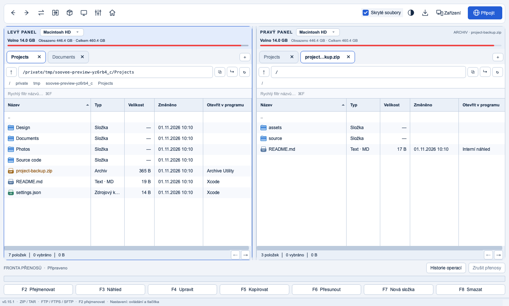

# Soovee Commander

[English](README.md) · Čeština

Dvoupanelový správce souborů pro macOS, Windows, Android, Android TV, iPhone a iPad. Ovládání z klávesnice, záložky, procházení archivů, FTP/FTPS/SFTP a integrovaný prohlížeč a editor.



## Instalace

Testovací verze jsou v [GitHub Releases](https://github.com/kolikkulda/soovee-commander/releases). Licence knihoven: [stav distribuce](THIRD_PARTY_NOTICES.md).

- **macOS Apple Silicon:** otevřít DMG a přetáhnout `SooveeCommander.app` do Applications.
- **Windows x64:** spustit instalátor `SooveeCommander-…-setup.exe`, případně rozbalit přenosný ZIP a spustit `SooveeCommander.exe`.
- **Android / Android TV:** jeden podepsaný APK pro ARM i x86 (32 i 64 bit), Android 7+. [Instalace a omezení](docs/mobile.md).
- **iPhone / iPad:** zatím jen vývojové sestavení, ne App Store.
- Python ani další knihovny se k hotovým balíčkům ručně neinstalují.

[Instalace, aktualizace a přechod ze staršího názvu](docs/installation.md).

## Funkce

- Dva panely se samostatnými záložkami, historií, vložením a kopírováním cest.
- Kopírování, přesun, přejmenování, koš, fronta operací a podrobný průběh.
- Nastavitelné sloupce, svislé oddělovače a volitelně připnutý název a ochrana proti vodorovnému posunu trackpadem.
- Procházení archivů bez rozbalení celého obsahu; rozbalování výběru a vytváření podporovaných archivů.
- FTP, explicitní FTPS a SFTP; uložená pojmenovaná připojení.
- F3 prohlížeč a F4 editor, hledání a nahrazování, kódování a konce řádků.
- Hledání v názvech i obsahu, porovnání složek a hromadné přejmenování.
- Rozšířené masky hromadného přejmenování, výběr znaků a počítadla; volitelné seznamy, ikony a místní miniatury.
- Čeština a angličtina, světlé a tmavé motivy, vlastní klávesové zkratky.
- Soovee Přenosy: párování QR/kódem a zpřístupnění vybraných složek. První [nativní testovací klient pro Android a Android TV](docs/mobile.md) sdílí aplikační složku Shared.
- Diagnostický log a „O programu“ s verzí a licencemi.

[Přesný rozsah a omezení](docs/features.md) · [Stav jednotlivých platforem](docs/platforms.md).

## Spuštění ze zdrojů

Python 3.13 nebo novější:

```sh
python3 -m venv .venv
source .venv/bin/activate
python -m pip install -e '.[dev]'
python -m soovee_commander
```

Ve Windows aktivujte `.venv\Scripts\activate`. Pomocné spouštěče jsou `Run.command` a `Run.bat`.

[Vývoj, testy a sestavení balíčků](docs/development.md).

## Licence

Vlastní kód je zdarma a open source pod [MIT licencí](LICENSE). Knihovny mají vlastní licence, jejich texty jsou přiložené v aplikaci. [Licence komponent a stav distribuce](THIRD_PARTY_NOTICES.md).
