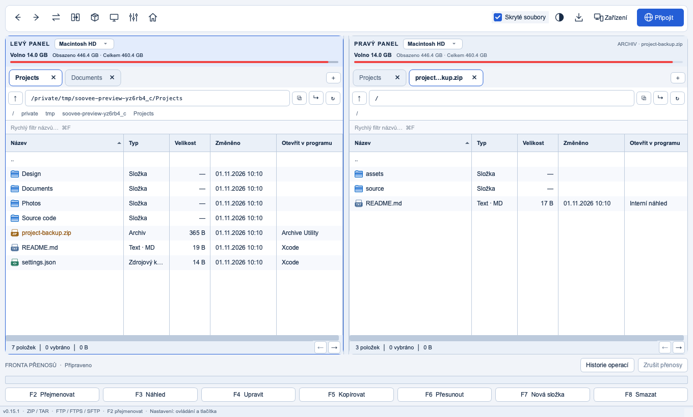

# Soovee Commander

English · [Čeština](README.cs.md)

A two-panel file manager for macOS, Windows, Android, Android TV, iPhone and iPad. Keyboard-driven, with tabs, archive browsing, FTP/FTPS/SFTP, a built-in viewer and editor, and direct transfers between your own devices.



> Test builds. Please report problems in [Issues](https://github.com/kolikkulda/soovee-commander/issues) and attach the diagnostic log (Help › Diagnostic log on desktop, Settings › Diagnostic log on iPhone).

## Install

Download the files from [Releases](https://github.com/kolikkulda/soovee-commander/releases).

- **macOS (Apple Silicon):** open the DMG and drag `SooveeCommander.app` to Applications. The app is not notarized yet: the first time, right-click it and choose Open.
- **Windows (x64):** run `SooveeCommander-…-setup.exe`, or unpack the portable ZIP and run `SooveeCommander.exe`.
- **Android and Android TV:** install `SooveeCommander-…-android-universal.apk` (Android 7 or newer, ARM and x86, 32 and 64 bit). [Details and limits](docs/mobile.md).
- **iPhone and iPad:** not distributed yet (development builds only).
- Python and libraries are bundled; nothing else needs to be installed.

**Updates:** on macOS and Windows, download the `.stereoupdate` file for your system and choose Help › Install update. Packages are signed and checked before installation. Each release lists SHA-256 checksums.

## Features

- Two panels with separate tabs and history; copy, move, rename, trash, an operation queue and detailed progress.
- Configurable columns, sorting by date added and last opened (macOS), automatic folder refresh.
- Archive browsing without unpacking; extracting selections and creating ZIP, 7z and TAR archives.
- FTP, explicit FTPS and SFTP with saved connections.
- F3 viewer and F4 editor; built-in previews of images, PDF, Markdown, CSV and office documents.
- Search by name and content, folder comparison and multi-rename with masks and counters.
- English and Czech, light and dark themes, custom keyboard shortcuts.
- Soovee Transfers: pair devices with a code or QR code and share chosen folders between computers, phones and TVs on the local network, encrypted with TLS 1.3.
- iPhone and iPad: a file manager for the app's folder and folders chosen in Files, with previews, search, archives and two panels on iPad.

[Scope and limits](docs/features.md) · [Platform status](docs/platforms.md)

## Run from source

Python 3.13 or newer:

```sh
python3 -m venv .venv
source .venv/bin/activate
python -m pip install -e '.[dev]'
python -m soovee_commander
```

On Windows activate `.venv\Scripts\activate`. `Run.command` and `Run.bat` are helper launchers.

## License

The project's own code is free and open source under the [MIT License](LICENSE). Bundled libraries keep their own licenses; their texts ship with the app. See [THIRD_PARTY_NOTICES.md](THIRD_PARTY_NOTICES.md).
